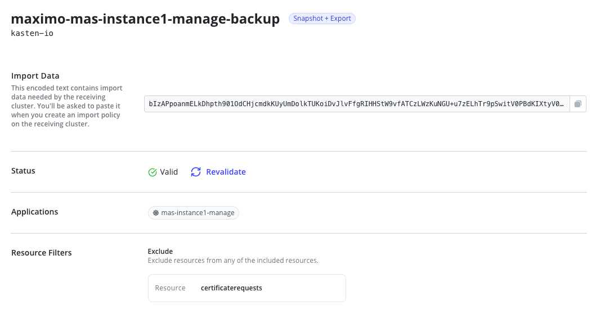

# Goal

Explain how the namespace `mas-$MAS_INSTANCE_ID-manage` should be backed up

# Backup 

Create a policy that backs up the whole namespace. 

**But you must exclude CertificateRequest**: CertificateRequest objects are ephemeral — they're transient objects created by cert-manager to fulfill a Certificate, then typically completed/garbage-collected. They shouldn't be restored at all, they should not be backed up at all. Their webhook rejects any PUT that tries to change spec. K10's overwriteExisting path calls Update (PUT) on all unstructured resources, hitting this webhook validation.




If the PVCs support CSI snapshots just backup as usual.

If the PVCs are CephFS you'll have to use [Shallow volume configuration](../../../ceph/cephfs/)

## If the PVCs do not support CSI snapshots

We do not encourage the use of [Generic Storage Backup](../../../gsb/) because: 

- Sidecar injection must be done on a lot of workloads and it's difficult to maintain, maintaining all the deployment injection is a daunting task
- GSB on openshift always creates security challenges and [proper setting must be engaged](../../../gsb/)
- Once you have injected the container, any update of Kasten will require that you upgrade all the injected containers
- You may have to review requests and limits for your pods now that they embed the data mover container

Instead exclude all the PVCs in the policy and use VBR (Veeam Backup and Replication) to treat the files share as a NAS. For instance in this [knowledge base](https://www.veeam.com/kb4011) you'll see how to configure VBR to backup azure file shares. We also provide a [detailed guide](./VBR_Azurefileshare_Kub.pdf) for step by step configuration for azure file share. 

If you use VBR however you need to map the name of the physical volume with the name of the PVC in the maximo namespace so that 
you know in which VBR backup you need to restore the files. You can easily save this info in a config map before you start a backup using the 
[pvc-info blueprint](https://github.com/michaelcourcy/kasten-claude/tree/main/pvc-info).
 
# Restore

Only the top objects (ManageWorkspace, ManageDeployment, ManageBuild) and, if Kasten backs them up, the PVCs need to be restored. 
All the other resources of the namespace are derived from the top objects and will be recreated by the operator during reconciliation.

## Step 1: scale down all the deployments

Save the current number of replicas, then scale down all the deployments in the manage namespace, so that no pod is using the PVCs 
or connected to the database when they are restored:

```
oc get deployment -n mas-${MAS_INSTANCE_ID}-manage -o custom-columns=NAME:.metadata.name,REPLICAS:.spec.replicas --no-headers > manage-replicas.txt
oc scale --replicas 0 deployment --all -n mas-${MAS_INSTANCE_ID}-manage
```

## Step 2 (optional): restore the database

If you want the state of Manage to be in sync with the restore point (for instance the files in the PVCs must match the records in the database), 
restore the database now, while Manage is scaled down and cannot reach it, from a restore point taken at the same time:

- If Manage uses DB2u, restore the db2u namespace as explained in the [db2u guide](../db2u/README.md#restore-steps).
- If Manage uses an external database, restore it with the tools of this database.

If you only want to get back the Manage namespace and keep the current database, skip this step.

## Step 3: restore the top objects (and the PVCs if Kasten backs them up)

Restore only the top objects ManageWorkspace, ManageDeployment, ManageBuild with "overwrite existing". This will ensure a consistent reconciliation when reconciliation will start. 

**If Kasten is responsible for the backup of the PVCs, you must also select all the PVCs in this restore**, together with the top objects. 
Kasten restores the volumes before the other resources, so the PVCs will be in place with their data when the operator starts reconciling 
the top objects. If you don't, the operator will create new, empty PVCs with the same names and mount them in the pods it creates. 
Restoring the data later would mean replacing PVCs that are already bound and in use, which is harder and less reliable.

Do not select the pods or the CertificateRequests if they are present in the restore point.

If the PVCs are backed up by VBR, there are no PVCs in the restore point: see [If you manage the backup of the PVCs with VBR](#if-you-manage-the-backup-of-the-pvcs-with-vbr).

## Step 4: scale up the deployments

Scale the deployments back to their original number of replicas:

```
while read name replicas; do
  oc scale --replicas $replicas deployment $name -n mas-${MAS_INSTANCE_ID}-manage
done < manage-replicas.txt
```

The operator then reconciles the top objects and recreates all the derived resources. The reconciliation is a long process 
(it involves the rebuild of all the images), so wait until the ManageWorkspace and ManageDeployment are ready before checking the application.

## If you manage the backup of the PVCs with VBR 

In this situation the PVCs are already excluded from the restore point, and those PVCs won't be recreated by Kasten. If the restoration of the files 
inside those PVCs are needed they should be handled with VBR.

## If you use S3 or Azure blob storage for your files 

The configuration of your s3 or azure blob storage is saved in the manage database, as soon as you restore it Manage will reconnect to this object storage.


