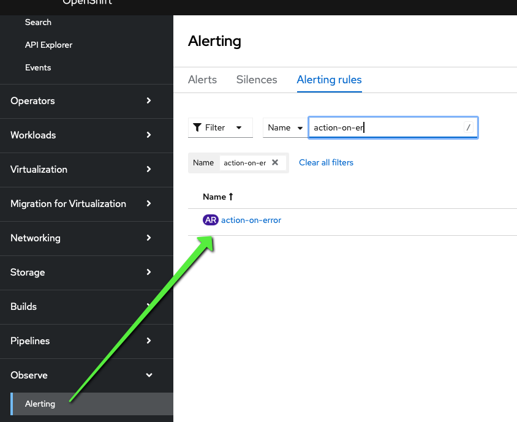

# OpenShift Integration

You can apply the [alerting rules](./kasten-rules.yaml) directly in OpenShift
if user workload monitoring is activated. Both the Prometheus stack and the
OpenShift monitoring stack use the `prometheusrules.monitoring.coreos.com` CRD.

> Tested end to end with Kasten 9.0.11 on OpenShift 4.21 (19 Nov 2026): metrics
> scraped, rules evaluated by Thanos Ruler, alerts delivered by the user workload
> Alertmanager.

## Configure OpenShift User Workload Monitoring

1. Make sure the ConfigMap `cluster-monitoring-config` in the `openshift-monitoring` namespace has
`enableUserWorkload: true`. On a new cluster this ConfigMap does not exist: create it. If it
already exists, add the key with `oc edit` instead of replacing it, so you keep the other settings.

For instance, this is the ConfigMap in my OpenShift cluster:
```
kind: ConfigMap
apiVersion: v1
metadata:
  name: cluster-monitoring-config
  namespace: openshift-monitoring
data:
  config.yaml: |
    enableUserWorkload: true
```

2. Make sure the ConfigMap `user-workload-monitoring-config` in the `openshift-user-workload-monitoring` namespace has Alertmanager enabled.

For instance, this is the ConfigMap in my OpenShift cluster:
```
kind: ConfigMap
apiVersion: v1
metadata:
  name: user-workload-monitoring-config
  namespace: openshift-user-workload-monitoring
data:
  config.yaml: |
    alertmanager:
      enabled: true
      enableAlertmanagerConfig: true
```

OpenShift creates this ConfigMap empty when user workload monitoring is enabled.
Use `oc edit` (or `oc apply`) to set the content.

You should then see the pods `alertmanager-user-workload-0` and `alertmanager-user-workload-1` in the `openshift-user-workload-monitoring` namespace starting.

## Apply the Alerting Rules

```
oc apply -f kasten-rules.yaml
oc apply -f kasten-kube-state-rules.yaml
```

[kasten-kube-state-rules.yaml](./kasten-kube-state-rules.yaml) adds `kasten-deployment-down`,
based on kube-state-metrics (see [Limitations](#limitations-on-openshift)).

> This file was called `kasten-ocp-rules.yaml` before. If you applied it, delete the old rule
> to avoid duplicate alerts: `oc delete prometheusrule -n kasten-io kasten-ocp-rules`

## OpenShift monitoring uses a ServiceMonitor, not a scrape config

OpenShift monitoring does not use the [scrape config](./kasten-scrape-config.yaml). It discovers
targets through ServiceMonitors.

The Prometheus embedded in Kasten scrapes 16 endpoints on 13 services plus the executor pods.
The metrics used by the rules are spread over several of them, and not always on port 8000:

| Metric | Service, port |
|---|---|
| `action_ended_total`, `action_skipped_total`, `catalog_persistent_volume_free_space_percent` | catalog-svc, `http` (8000) |
| `policies_count` | controllermanager-svc, `http` (8000) |
| `metering_license_compliance_status` | metering-svc, `http` (8000) |
| `events_service_event_groups` | state-svc, `events` (8001) |
| `repository_data_procedure_total` | crypto-svc, `repositories` (8003) |

Apply [kasten-ocp-servicemonitor.yaml](./kasten-ocp-servicemonitor.yaml). It is a single
ServiceMonitor that scrapes the same endpoints as the embedded Prometheus:

```
oc apply -f kasten-ocp-servicemonitor.yaml
```

It selects all the Kasten services except those without metrics, and declares one endpoint per
metrics port name. A service that does not have a given port is ignored for that endpoint. It also
adds the labels `application="k10"` and `app="k10"` on every target, executors included, so
`kasten-service-down` (`up{application="k10"} == 0`) covers all of them.

If several clusters send their alerts to the same receiver, uncomment the `cluster` relabeling
in the ServiceMonitor and set the name of the cluster. The rules then add `on cluster <name>`
to the summary and the description of every alert.

After a minute you should have 19 targets `up` in `kasten-io` (Observe > Targets in the console).

> Older versions of this page created 5 ServiceMonitors (catalog, controllermanager, metering,
> dashboardbff, crypto, port `http` only). With those, `kasten-event-group`,
> `kasten-full-maintenance-failed` and `kasten-service-down` (for the executors) never fire.
> Delete them before applying the new one:
> `oc delete servicemonitor -n kasten-io catalog-metrics controllermanager-metrics metering-metrics dashboardbff-metrics crypto-metrics`

## Allow the Monitoring Namespace to Scrape kasten-io Pods

Kasten installs a `default-deny` NetworkPolicy in `kasten-io`, so the Prometheus pods
running in `openshift-user-workload-monitoring` cannot reach the scrape targets
without an explicit ingress rule. Without it, all the targets except the gateway
are `down` with `context deadline exceeded`.

Apply the following NetworkPolicy once in the `kasten-io` namespace:

```
oc apply -f kasten-ocp-monitoring-netpol.yaml
```

or inline:

```
cat <<EOF | oc apply -f -
apiVersion: networking.k8s.io/v1
kind: NetworkPolicy
metadata:
  name: allow-openshift-user-workload-monitoring
  namespace: kasten-io
spec:
  podSelector: {}
  policyTypes:
  - Ingress
  ingress:
  - from:
    - namespaceSelector:
        matchLabels:
          kubernetes.io/metadata.name: openshift-user-workload-monitoring
EOF
```

The `podSelector: {}` matches all pods in `kasten-io`. The namespace selector
uses the `kubernetes.io/metadata.name` label that Kubernetes sets automatically
on every namespace, so no manual labelling is required.

## Check the Alerting Rules Are Activated

Now check that the new configuration has been injected in Thanos:

```
oc get cm -n openshift-user-workload-monitoring thanos-ruler-user-workload-rulefiles-0 -o yaml
```

You should see one entry per PrometheusRule. OpenShift adds `namespace="kasten-io"` to every
expression, so a rule only sees the metrics of its own namespace:

```
apiVersion: v1
data:
  kasten-io-kasten-kube-state-rules-<uid>.yaml: |
    ...
  kasten-io-kasten-rules-<uid>.yaml: |
    groups:
    - name: ./kasten.rules
      rules:
      - alert: kasten-catalog-over-50-percent
        ...
        expr: 100 - catalog_persistent_volume_free_space_percent{namespace="kasten-io"}
          > 50
      - alert: kasten-failed-action
        ...
        expr: increase(action_ended_total{namespace="kasten-io",state="failed"}[1h])
          > 0
      ...
```

Forcing `namespace` does not lose the application namespace: the action metrics
(`action_ended_total`, `action_skipped_total`) carry it in `app_namespace`, which the
descriptions in [kasten-rules.yaml](./kasten-rules.yaml) display. Route on `app_namespace`
to send the failed actions of one application to its own team.

You can also find them in the UI:



## Configure a receiver to send the alert somewhere

OpenShift already creates the secret `alertmanager-user-workload` with a default
configuration, so use `oc apply` (an `oc create` fails with `AlreadyExists`):

```
cat <<EOF | oc apply -f -
kind: Secret
apiVersion: v1
metadata:
  name: alertmanager-user-workload
  namespace: openshift-user-workload-monitoring
  labels:
    app.kubernetes.io/name: alertmanager
stringData:
  alertmanager.yaml: |
                     global:
                       smtp_smarthost: "smtp-relay.brevo.com:587"
                       smtp_from: "michael@kasten.com"
                       smtp_auth_username: "michael.courcy@veeam.com"
                       smtp_auth_password: "xxxxx"
                       smtp_require_tls: false
                     route:
                       # catch-all for the alerts of the other applications (istio, ...)
                       receiver: "default"
                       routes:
                       # only the Kasten alerts reach the backup team;
                       # keep this route first, it stops the Kasten alerts here
                       - receiver: "kasten-backup-team"
                         matchers:
                         - namespace = "kasten-io"
                         - alertname =~ "kasten-.*"
                     receivers:
                     # no integration: alerts routed here are dropped,
                     # replace with the receiver of the platform team if you have one
                     - name: "default"
                     - name: "kasten-backup-team"
                       email_configs:
                       - to: "support@kasten.io,ops-team@example.com"
                         headers:
                           Subject: '[Kasten][{{ .Status | toUpper }}] {{ range .Alerts }}{{ .Annotations.summary }}{{ end }}'

type: Opaque
EOF
```

### Route only the Kasten alerts to the backup team

The Alertmanager of user workload monitoring is shared by every application that defines
a `PrometheusRule` (Istio, your own apps, ...). Do not use the backup team's receiver as the
top-level `receiver`: it is the catch-all and would send them every alert.

Route on the `namespace` label instead. OpenShift forces `namespace` to the namespace of the
`PrometheusRule` on every alert it generates (see
[Check the Alerting Rules Are Activated](#check-the-alerting-rules-are-activated)), so all
the Kasten alerts carry `namespace="kasten-io"`, and the rules of another namespace cannot
produce an alert with that label. The `alertname =~ "kasten-.*"` matcher also excludes any
other rule someone would create in `kasten-io`: all the Kasten rules are named `kasten-*`.

The route is first and has no `continue`, so a Kasten alert stops there and never reaches
the routes of the other teams.

#### Alternative: let the backup team own its routing with an `AlertmanagerConfig`

If several teams share the cluster, editing a single secret for everyone does not scale.
OpenShift can let each team define an `AlertmanagerConfig` in its own namespace. Enable it in
the ConfigMap `user-workload-monitoring-config`:

```yaml
    alertmanager:
      enabled: true
      enableAlertmanagerConfig: true
```

Then create the routing in `kasten-io`:

```yaml
apiVersion: monitoring.coreos.com/v1beta1
kind: AlertmanagerConfig
metadata:
  name: kasten-backup-team
  namespace: kasten-io
spec:
  route:
    matchers:
    - name: namespace
      value: kasten-io
      matchType: =
    - name: alertname
      value: kasten-.*
      matchType: =~
    receiver: kasten-backup-team
  receivers:
  - name: kasten-backup-team
    emailConfigs:
    - to: "support@kasten.io,ops-team@example.com"
      smarthost: "smtp-relay.brevo.com:587"
      from: "michael@kasten.com"
      authUsername: "michael.courcy@veeam.com"
      authPassword:
        name: kasten-smtp          # a Secret in kasten-io
        key: password
      requireTLS: false
```

This is [kasten-alerting-backup-team.yaml](./kasten-alerting-backup-team.yaml) with an email
receiver. The explicit `namespace` matcher is redundant on OpenShift: the operator adds a
`namespace="kasten-io"` matcher to this route anyway, so it can only receive the Kasten
alerts, whatever the team writes in it.

The operator always sets `continue: true` on this route and places it before the routes of
the secret `alertmanager-user-workload`, so after the backup team, a Kasten alert goes on
through the routes of the secret. If one of them matches it (for instance
`severity = "critical"` to an on-call team), that team receives it too. To make sure the
Kasten alerts reach only the backup team, start the routes of the secret with a route that
stops them:

```yaml
route:
  receiver: "default"
  routes:
  # the Kasten alerts were already sent by the AlertmanagerConfig route: stop them here
  - receiver: "kasten-stop"
    matchers:
    - namespace = "kasten-io"
    - alertname =~ "kasten-.*"
  # ... the routes of the other teams
receivers:
- name: "default"
- name: "kasten-stop"   # no integration: nothing is sent
```

### Multiple recipients

The `to` field accepts a comma-separated list of addresses:

```
to: "support@kasten.io,ops-team@example.com"
```

### Customising the email subject

Use the `headers` map with a Go template string. The subject above produces
messages like `[Kasten][FIRING] Action on error`.

### Customising the email body

Alertmanager generates the body from a Go template. If you set neither `html`
nor `text` in `email_configs`, it falls back to its built-in HTML template,
which already renders the `summary`, `description`, and `runbook_url`
annotations defined in [kasten-rules.yaml](./kasten-rules.yaml) — so no custom
body is required unless you want specific layout or branding.

To override, add an `html` (or `text`) field to `email_configs`:

```yaml
email_configs:
- to: "support@kasten.io,ops-team@example.com"
  headers:
    Subject: '[Kasten][{{ .Status | toUpper }}] {{ range .Alerts }}{{ .Annotations.summary }}{{ end }}'
  html: |
    <h2>Kasten Alert — {{ .Status | toUpper }}</h2>
    {{ range .Alerts }}
    <p><b>{{ .Annotations.summary }}</b><br/>
    {{ .Annotations.description }}<br/>
    Severity: {{ .Labels.severity }}<br/>
    <a href="{{ .Annotations.runbook_url }}">Runbook</a></p>
    {{ end }}
```

The main template variables available in both `html` and `text` are:

| Variable | Content |
|---|---|
| `.Status` | `"firing"` or `"resolved"` |
| `.Alerts` | all alerts in the group |
| `.Alerts.Firing` | only firing alerts |
| `.Alerts.Resolved` | only resolved alerts |
| `.CommonLabels` | labels shared by all alerts |
| `.CommonAnnotations` | annotations shared by all alerts |
| `.GroupLabels` | labels used to group this batch |

Each alert inside `range .Alerts` exposes `.Labels.<name>`,
`.Annotations.<name>`, `.StartsAt`, `.EndsAt`, and `.GeneratorURL` (a link back
to the Prometheus expression that triggered the alert).

## Limitations on OpenShift

### A Kasten service with no ready pod does not trigger `kasten-service-down`

The embedded Prometheus scrapes each service by its DNS name, so a service with no
ready pod gives `up == 0`. A ServiceMonitor only scrapes the ready pods behind the
service: when a deployment is scaled to 0 or all its pods are crashing, the target
disappears and `kasten-service-down` does not fire. `kasten-deployment-down` in
[kasten-kube-state-rules.yaml](./kasten-kube-state-rules.yaml) covers that case (tested by scaling
`jobs-svc` to 0).

### `kasten-dr-policy-not-in-place` checks DR backups, not the policy count

This is not specific to OpenShift. Kasten counts the DR policy as
`policies_count{action="k10dr"}` only when it has a single action. In the
[Exported Catalog Snapshot](../dr/readme.md) mode the DR policy has a backup and an
export action, so it is counted as `action="backup",chained="export"` and a rule on
`action="k10dr"` fires although DR is healthy.

The rule in [kasten-rules.yaml](./kasten-rules.yaml) therefore fires when no DR backup
succeeded in the last 25 hours. It works with every KDR mode and also catches a DR policy
that was deleted, disabled or keeps failing. On a fresh install, it clears only after the
second successful DR run (Prometheus' `increase()` ignores the first sample of a new series).
Adapt `25h` if your DR policy runs less often than daily.

## Troubleshoot Alertmanager when emails are not received

### 1. Check pods are healthy

```
oc get pods -n openshift-user-workload-monitoring
```

You should see `alertmanager-user-workload-0` and `alertmanager-user-workload-1`
in `Running` state.

### 2. Read Alertmanager logs

```
oc logs -n openshift-user-workload-monitoring alertmanager-user-workload-0
```

SMTP connection errors, authentication failures, or template rendering errors
appear here. Look for lines containing `error` or `msg="Notify"`.

### 3. Open the Alertmanager UI

Port-forward to the Alertmanager pod and open the web UI in your browser:

```
oc port-forward -n openshift-user-workload-monitoring alertmanager-user-workload-0 9093
```

Then open `http://localhost:9093`.

- **Alerts tab** — shows all alerts currently received by Alertmanager. If empty,
  the problem is upstream (alerts are not firing in Prometheus/Thanos).
- **Status > Config tab** — shows the configuration Alertmanager actually loaded.
  Compare it against your secret to confirm the YAML was parsed correctly.
- **Status > Receivers tab** — lists the configured receivers and their integration
  status.

### 4. Verify the secret is correctly formatted

Alertmanager silently ignores a malformed secret. Decode and inspect it:

```
oc get secret alertmanager-user-workload \
  -n openshift-user-workload-monitoring \
  -o jsonpath='{.data.alertmanager\.yaml}' | base64 -d
```

The output must be valid YAML with correct indentation.

### 5. Check that alerts are actually firing in Thanos

Port-forward to the Thanos Ruler UI:

```
oc port-forward -n openshift-user-workload-monitoring \
  $(oc get pod -n openshift-user-workload-monitoring -l app.kubernetes.io/name=thanos-ruler -o name | head -1) 10902
```

Open `http://localhost:10902/rules` and verify the Kasten rules are listed and
that their state is `firing` when expected.

### 6. Send a test alert manually

You can push a synthetic alert directly to Alertmanager to verify the receiver
works independently of the rules:

```
oc port-forward -n openshift-user-workload-monitoring alertmanager-user-workload-0 9093

curl -s -X POST http://localhost:9093/api/v2/alerts \
  -H 'Content-Type: application/json' \
  -d '[{
    "labels":      {"alertname":"test-alert","severity":"critical","namespace":"kasten-io"},
    "annotations": {"summary":"Test alert","description":"Sent manually to verify email delivery"}
  }]'
```

If the email arrives, the receiver is correctly configured and the issue is that
no real alerts are firing. If it does not, check the logs again (step 2) for the
exact SMTP error.